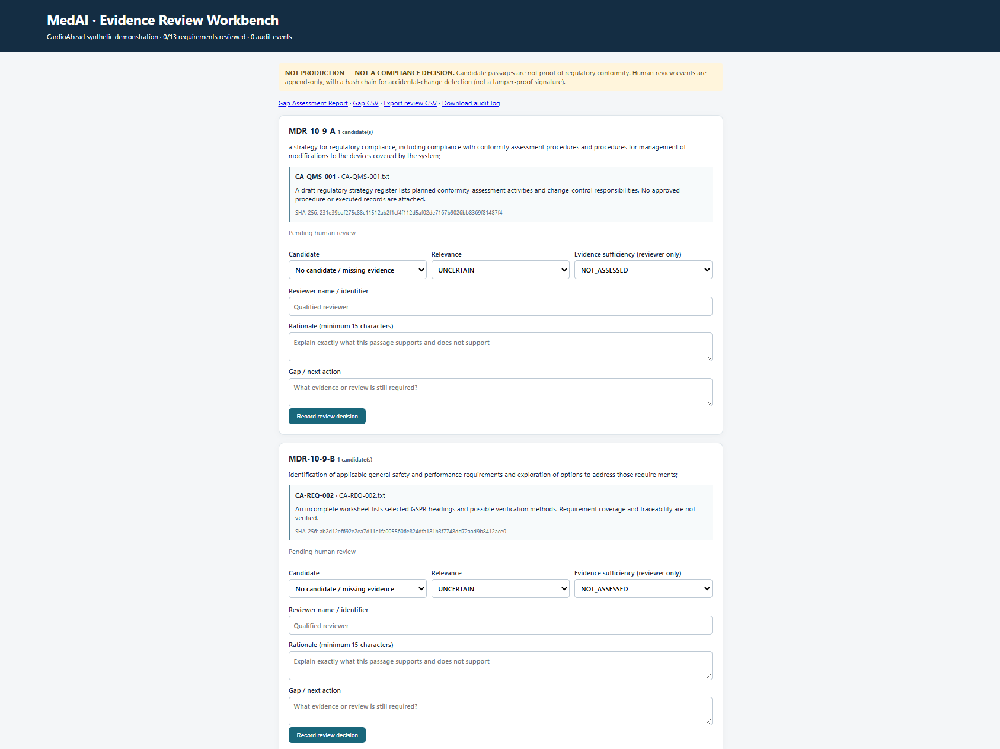
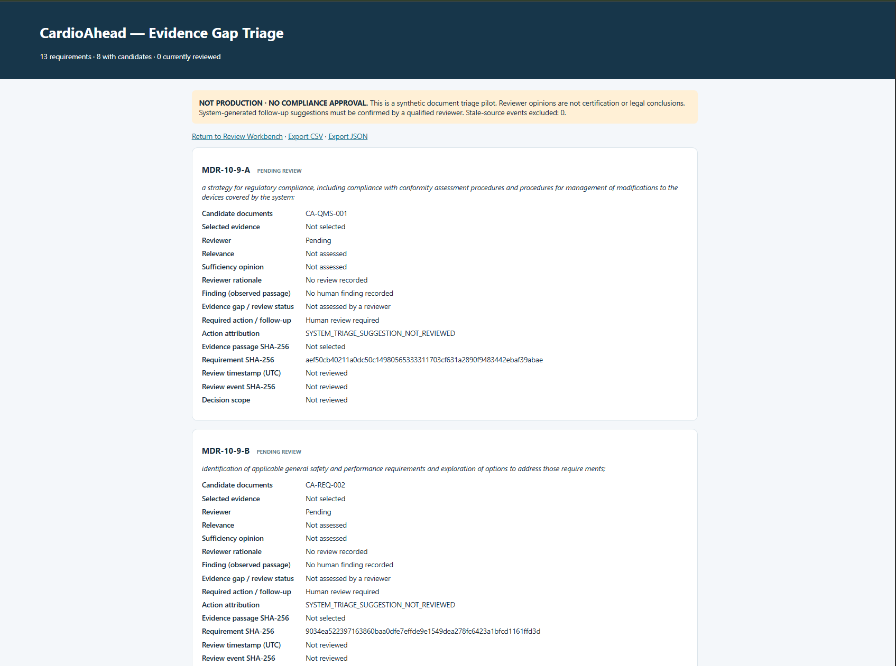

# MedAI Regulatory Intelligence & Assurance

**Human-in-the-loop evidence triage for medical device regulatory review**  
**Status:** Portfolio MVP v1.0 · Synthetic demonstration only · **NOT PRODUCTION**

> This project is not a regulatory compliance engine, a CE certification tool, or a substitute for qualified regulatory and quality professionals.

## Problem

Medical-device teams must connect regulatory requirements to controlled documentation, determine whether a passage is relevant, assess its evidentiary sufficiency, and document follow-up actions. Document retrieval alone cannot establish conformity.

## Approach

MedAI implements a local, transparent workflow for a synthetic software-as-a-medical-device (SaMD) case study, **CardioAhead**:

1. **Requirement inventory:** 13 extracted clauses of EU MDR Article 10(9)(a–m).
2. **Document-based candidate retrieval:** heuristic lexical/concept matching over seven synthetic text documents; no manually preassigned evidence links in the integrated matching path.
3. **Source traceability:** verbatim passages with offsets and SHA-256 hashes.
4. **Human review:** reviewer records relevance, sufficiency opinion, rationale and follow-up in a localhost browser application.
5. **Assurance Gap Report:** HTML, CSV and JSON views showing findings, evidence gaps, follow-up actions and review attribution.
6. **Audit visibility:** append-only JSONL events with a SHA-256 hash chain (integrity aid, **not** secure digital signing).

## Architecture

```text
Synthetic CardioAhead documents + extracted MDR clause inventory
                             |
                 Content-based matching (run.py)
                             |
              assessment.json / review_queue.csv
                             |
             Human Review Workbench (localhost)
                             |
             Append-only review_events.jsonl
                             |
                 Assurance Gap Report
                      HTML / CSV / JSON
```

**Technology:** Python 3.12, Python standard-library HTTP server, local JSON/JSONL and CSV, HTML. PDF/DOCX extraction is optional in the matching CLI and requires extra libraries. The **integrated MVP is a transparent heuristic evidence-retrieval and human-review tool**, not a demonstrated LLM-based entailment or regulatory decision engine.

## Demonstrated scenario: MDR Article 10(9)(l)

**Requirement:** Management of corrective and preventive actions (CAPA) and verification of their effectiveness.

**Retrieved candidate:** `CA-CAPA-007` (synthetic draft CAPA workflow).

**Observed passage:** A draft workflow lists corrective action stages but includes no effectiveness-verification records.

**Pilot reviewer opinion:** `RELEVANT / INSUFFICIENT`.

**Follow-up suggestion:** Request an approved CAPA procedure and documented effectiveness-verification records for completed CAPA actions. This suggestion is explicitly tagged `SYSTEM_TRIAGE_SUGGESTION_NOT_REVIEWED`, **not an approved action**.

**Decision scope:** `EVIDENCE_TRIAGE_ONLY_NOT_LEGAL_COMPLIANCE`.

## Run locally (Windows)

Unzip the release into a directory containing `MedAI_Integrated_v1` and use Python 3.12. From that directory:

```powershell
python .\MedAI_Integrated_v1\review_workflow.py check
python -m unittest discover -s .\MedAI_Integrated_v1\tests -p "test_*.py" -v
python .\MedAI_Integrated_v1\review_workflow.py serve --port 8766
```

Open the **exact addresses** in your browser, not PowerShell:

- `http://127.0.0.1:8766/` — Human Review Workbench
- `http://127.0.0.1:8766/gap-report` — Assurance Gap Report
- `http://127.0.0.1:8766/gap-report.json` — machine-readable report
- `http://127.0.0.1:8766/gap-report.csv` — spreadsheet-friendly report

Keep the server terminal open. Stop it using Ctrl+C. Avoid URL tracking/query parameters, because the current routing implementation uses exact paths.

To re-run document matching (rather than inspect the packaged pilot snapshot):

```powershell
python .\MedAI_Integrated_v1\run.py
```

**Caution:** Rebuilding `assessment.json` can change its SHA-256; older review events may then be treated as stale. Preserve the bundled pilot snapshot before regenerating it. The ZIP contains no virtual environment, installer or standalone executable.

## Verification recorded for this pilot

- **8/8** Integrated v1 unit tests passed in the author's Windows environment.
- **7/7** Assurance Report v1.1 upgrade tests passed in the author's Windows environment (upgrade test suite is not part of this clean MVP ZIP).
- Integrity check: **13 requirements, 2 audit events, `INTEGRITY: OK`**.
- A local HTTP request to `/gap-report` returned **200 OK**; CAPA review fields and SHA-256 identifiers were visible.

These results do **not** establish comprehensive functional validation, clean installation reproducibility across machines, regulatory correctness or cybersecurity assurance.

## Known issues and explicit exclusions

- **Pilot data-quality exception:** Review event for `MDR-10-9-A` contains an unrelated CAPA rationale and a copied UI word. It must **not** be presented as a valid regulatory-strategy finding; the historical event remains in the archive to preserve audit continuity.
- The CAPA pilot decision has no separately entered reviewer follow-up; the displayed action is a **system suggestion awaiting review**.
- MDR text was extracted from a document and includes extraction artifacts. Authoritative legal text has **not** been independently verified.
- No qualified clinical/regulatory validation, calibration on real documentation, or evidence of completeness/recall.
- No authentication, authorization, secure e-signature, cryptographic non-repudiation, patient-data safeguards or production deployment hardening.
- Synthetic case data only. The hypothesized SaMD classification is not a regulatory determination.

## Repository layout

```text
MedAI_Integrated_v1/
├── run.py                      # Document matching and output generation
├── review_workflow.py          # Local review UI, event handling, export
├── gap_report.py              # Assurance report generation
├── data/                      # Extracted clause inventory and synthetic inventory
├── docs_demo/                 # Seven synthetic document excerpts
├── output/                    # Fixed pilot assessment and audit snapshot
├── tests/test_integrated.py   # Integrated matching tests
└── START_HERE_MVP_RELEASE.md  # Release-specific setup and limits
```

## Responsible publication

All supplied case documents are synthetic. Before publishing a fork with other data, inspect every file, log, screenshot and Git history for personal data, commercial secrets, regulated information and credentials. Do not commit local `.venv/`, `.local/`, backup or Python cache directories. Review sample audit records openly and keep the documented data-quality exception visible.

## Next steps (not claimed as implemented)

Authoritative regulatory-text verification; expert-labeled retrieval/evidence sufficiency benchmark; clear correction/supersession workflow for review events; robust provenance; secure roles and audit logging; actual usability/quality-system validation.

**Positioning:** A technical demonstration of regulatory evidence traceability, human-in-the-loop quality review, and conservative uncertainty handling for SaMD assurance.

## Application Screenshots

### Human Review Workbench


### Assurance Gap Report


